# Файловая система Linux · отчёт

ФИО: Кожемякин Эрик Романович
Группа: РПО-1
Дата: 11.10.2026
Среда: установленная Debian 13 (только консоль)

## Корневой каталог

Команды:

```bash
pwd && ls -lah /
```

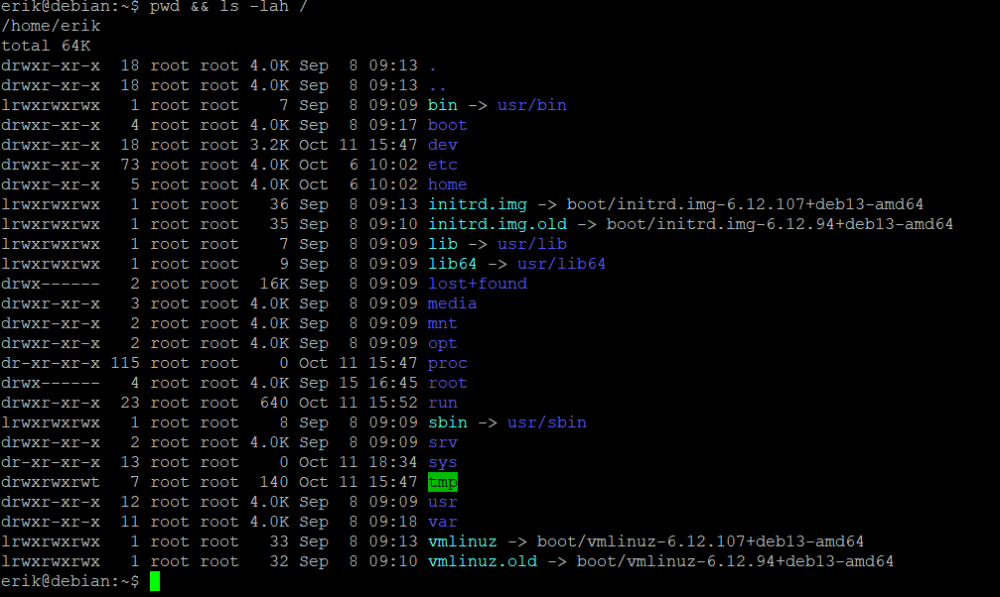

Результат: текущий путь и содержание корневого каталога

Что такое корневой каталог, чем абсолютный путь отличается от относительного.
>Корневой каталог (/) — это главная папка верхнего уровня, от которой строятся пути: абсолютный всегда начинается от этого корня и указывает точное место файла, а относительный отсчитывается от вашей текущей папки, не начинаясь со слэша.

Вывод: Несмтря на текущий каталог ls показала содержимое корневого каталога, потому что в параметрах указан абсолютный путь / 

## Домашний каталог

Команды:

```bash
cd ~ && pwd && ls -a
```

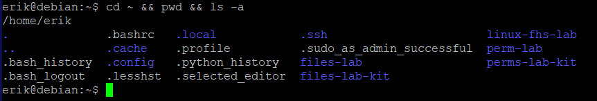

Результат: Текущим каталогом станет домашний, список файлов и папок домашнего каталога

Где находится домашний каталог, что такое скрытые файлы.
>Домашний каталог пользователя обычно находится по пути /home/имя_пользователя (для суперпользователя — /root), а скрытые файлы — это файлы, имена которых начинаются с точки (например, .bashrc), из-за чего они по умолчанию не видны в списке файлов.

Вывод: ls -a показывает скрытые файлы, например .bashrc

## Каталог /etc

Команды:

```bash
cat /etc/os-release && getent passwd
```

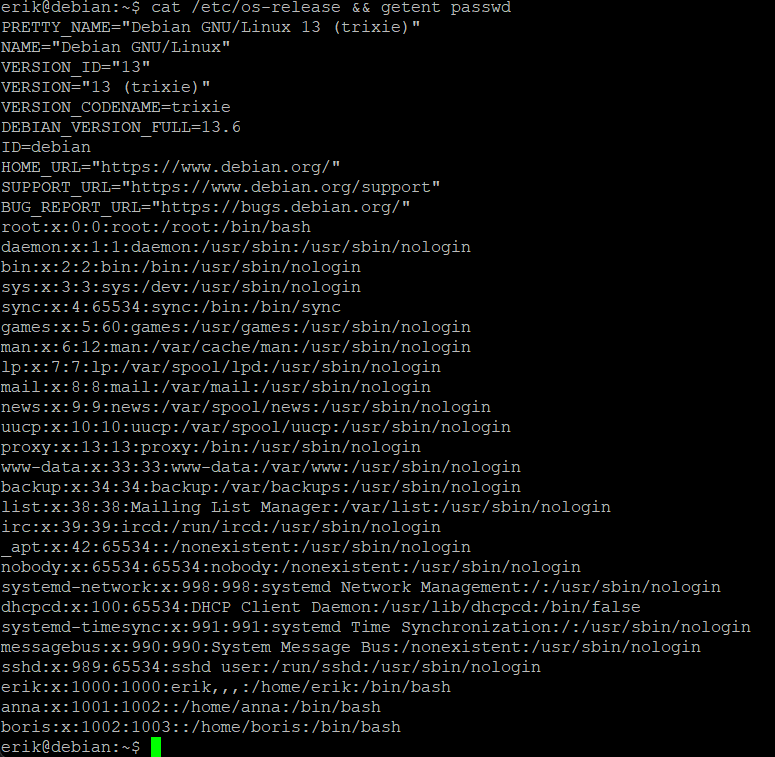

Результат: Информация о системе и список пользователей

Версия системы, UID, домашний каталог и оболочка.
> Версия системы Debian 13, UID 1000, домашний каталог /home/erik, оболочка /bin/bash


Вывод: Эти команды позволяют определить точную версию дистрибутива Linux и получить полный список пользователей системы с их UID и домашними каталогами.

## Программы и PATH

Команды:

```bash
 command -v python3 && type cd && echo $PATH
 ```

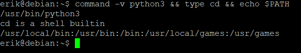

Результат: python3 находится в /usr/bin/python3, cd это команда, прграммы будут искаться по 5 путям

Как оболочка находит программу.
> Bash находит программу по двум правилам: если путь к ней указан явно (например, ./script или /bin/ls), он запускает её из этого места, а если введено только имя (например, git), bash ищет её по очереди в папках, перечисленных в системной переменной окружения $PATH.

Вывод: Эти команды позволяют узнать, как bash находит команды: они показывают точный путь к исполняемому файлу python3, подтверждают, что cd является встроенной функцией самого bash, и выводят список директорий из переменной $PATH, где система ищет сторонние программы.

## Изменяемые данные

Команды:

```bash
ls /var && findmnt -T /run
```

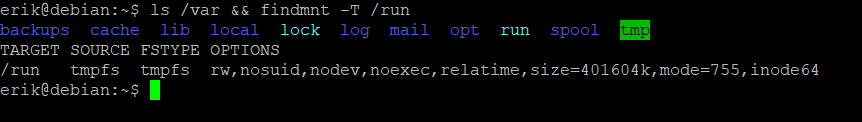

Результат: Выведен список содержимого папки /var и определена точка монтирования для /run (показано, что папка /run смонтирована в оперативную память как временная файловая система tmpfs).

Назначение /var/lib, /var/log, /var/cache и /run.
* /var/lib — хранение динамических данных состояния программ (например, баз данных).
* /var/log — системные журналы и логи работы приложений.
* /var/cache — кэшированные данные программ для ускорения их работы.
* /run — временные данные текущей сессии (PID-файлы, сокеты), которые удаляются при перезагрузке.


Вывод: Команды демонстрируют разделение изменяемых данных в Linux: каталог /var используется для постоянных файлов, растущих в процессе работы (логи, кэш, библиотеки), в то время как /run служит для хранения временных системных данных напрямую в оперативной памяти.

## Устройства

Команды:

```bash
ls -l /dev/null; echo $?
```

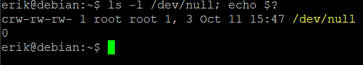

Результат: Команда ls -l вывела информацию о файле /dev/null с буквой c в начале строки прав доступа, а команда echo $? вернула код завершения 0.

Тип устройства и код завершения.
* Тип устройства: Символьное (знаковое) устройство — на это указывает буква c (character device) в выводе ls -l.
* Код завершения: 0 — означает, что предыдущая команда выполнилась успешно, без ошибок.


Вывод: Команды подтверждают, что виртуальное устройство /dev/null («черная дыра» Linux) является символьным устройством, а успешный код возврата 0 доказывает, что система имеет к нему беспрепятственный доступ.

## Файлы /proc

Команды:

```bash
cat /proc/uptime | tee ~/linux-fhs-lab/saved-uptime.txt; sleep 5; cat /proc/uptime; cat ~/linux-fhs-lab/saved-uptime.txt
```

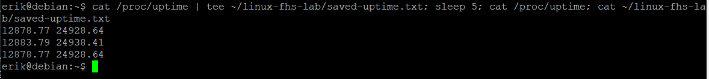

Результат: Первая и третья команды вывели текущее время работы системы (аптайм) из /proc/uptime (при этом значения увеличились на 5 секунд), а сохраненный в файле saved-uptime.txt результат остался прежним.

Почему копия не меняется.
>Файл /proc/uptime — это виртуальный файл ядра, который генерирует данные динамически в реальном времени, а в saved-uptime.txt была записана статическая копия (снимок) этих данных в конкретный момент времени.

Вывод: Файловая система /proc отражает актуальное состояние системы на момент обращения, поэтому при каждом чтении /proc/uptime значения обновляются, в то время как обычные файлы на диске хранят только неизменяемый текст до следующей перезаписи.

## Сетевые интерфейсы

Команды:

```bash
ls /sys/class/net
```

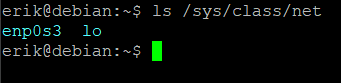

Результат: Команда вывела список сетевых интерфейсов системы, представленный именами папок: enp0s3 и lo

Какие интерфейсы есть в системе.
• enp0s3 — сетевой интерфейс Ethernet для подключения к сети и интернету.
• lo — локальная петля (loopback), используемая системой для обращения к самой себе (localhost).


Вывод: Каталог /sys/class/net предоставляет виртуальные файлы для управления сетевыми устройствами ядра, показывая, что в данной системе настроены два интерфейса: один для внешней сети, а второй — для внутренних нужд ОС.

## inode и ссылки

Команды:

```bash
ls -li; rm data/info.txt; cat info-link.txt
```

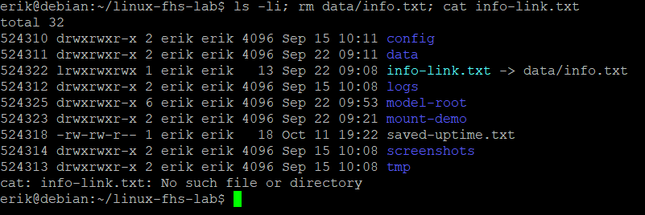

Результат: Команда ls -li вывела список файлов с их номерами inode. После удаления оригинального файла rm data/info.txt, команда cat info-link.txt выдала ошибку "No such file or directory" (ссылка символическая и стала "битой").

Чем жёсткая ссылка отличается от символической.

* Жесткая ссылка (Hard link): Указывает напрямую на тот же номер inode (индексный дескриптор), что и оригинал; файл доступен, пока жива хотя бы одна жесткая ссылка.
* Символическая ссылка (Symlink): Это отдельный файл, который содержит только текстовый путь к оригиналу; если оригинал удалить, ссылка ломается.


Вывод: Так как info-link.txt была символической ссылкой, удаление целевого файла data/info.txt сделало её неработоспособной (битой), поскольку сам файл-ссылка остался на месте, но путь, на который он указывал, перестал существовать.

## Место на диске

Команды:

```bash
findmnt /; df -h .; du -sh data
```

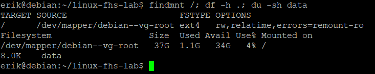

Результат: Выведена информация о корневой файловой системе (тип ext4, смонтирована на /dev/mapper/debian--vg-root), показано общее свободное место на диске в текущей папке (Size: 37G, Used: 1.1G, Avail: 34G) и объем, занимаемый каталогом data (12K).

Чем df отличается от du.
* df (disk free): Показывает состояние всей файловой системы в целом (общий размер, занятое и свободное пространство на смонтированных дисках).
* du (disk usage): Оценивает дисковое пространство, занятое конкретными файлами и папками (считает размер переданного ей объекта).


Вывод: Команда df используется для глобального мониторинга свободного места на диске со стороны операционной системы, в то время как du применяется локально для поиска конкретных директорий и файлов, которые занимают больше всего места.

## Монтирование tmpfs

Команды:

```bash
findmnt -T mount-demo; ls -l mount-demo
```

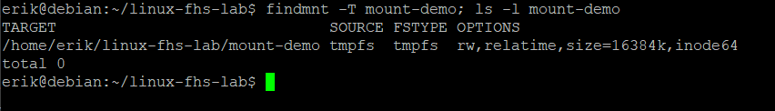

Результат: Видно что в папку mount-demo примонтирована tmpfs

Почему before.txt перестал быть виден.
>Файл before.txt находился на жестком диске, но после монтирования поверх этой папки новой файловой системы tmpfs старое содержимое «скрылось» под точкой монтирования. Физически файл не удалился, но стал временно недоступен.


Вывод: Монтирование новой файловой системы в существующую директорию временно перекрывает доступ к её старому содержимому, подменяя его пустым пространством новой смонтированной структуры (в данном случае — в оперативной памяти).

## Отключение tmpfs

Команды:

```bash
findmnt -T mount-demo; cat mount-demo/before.txt
```

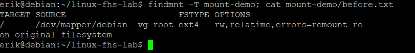

Результат: Команда findmnt показала, что файловая система tmpfs больше не смонтирована в mount-demo. Команда cat успешно прочитала старый файл before.txt.

Что стало с inside.txt.
>Файл inside.txt пропал (был полностью уничтожен), так как он был создан внутри файловой системы tmpfs, которая существует исключительно в оперативной памяти и полностью стирается при размонтировании.

Вывод: Размонтирование (umount) возвращает доступ к исходным файлам на диске, находившимся в папке до монтирования, но при этом безвозвратно уничтожает все временные данные, которые были записаны в tmpfs.

## Файлы shop-api

Команды:

```bash
find model-root -type f
```

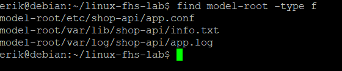

Результат: Видно распределение файлов по каталогам

Почему выбран каждый каталог.
> Каталоги выбраны по правилам FHS (подробнее в следующем разделе)


Вывод: Создано только 3 файла.

## Размещение shop-api

| Файл | Каталог | Основание |
|---|---|---|
| Исполняемый файл | /usr/bin (или /usr/sbin) | Содержит пользовательские команды и исполняемые файлы программ общего назначения. |
| Настройки | /etc/shop-api | Предназначен для статических конфигурационных файлов системы и служб. |
| База данных | /var/lib/shop-api | Хранит динамические данные о состоянии программ, которые меняются в процессе работы. |
| Журнал | /var/log/shop-api | Стандартное место для хранения логов и журналов работы приложений. |
| Номер процесса | /run/shop-api | Хранит временные данные о запущенных процессах (PID-файлы) текущей сессии в ОЗУ. |

## Итоговая задача

По правилам FHS, внутри структуры model-root нужно проверить правильность размещения 6 типов файлов.

### 1. Конфигурационный файл

* Текущий путь: model-root/etc/shop-api/app.conf
* Действие: Оставить
* Правильный путь: /etc/shop-api/app.conf
* Основание: Каталог /etc строго предназначен для конфигурационных файлов.

### 2. Файл базы данных / состояния

* Текущий путь: model-root/var/lib/shop-api/info.txt
* Действие: Оставить
* Правильный путь: /var/lib/shop-api/info.txt
* Основание: Динамические данные программ и базы данных должны жить в /var/lib.

### 3. Файл журнала (логов)

* Текущий путь: model-root/var/log/shop-api/app.log
* Действие: Оставить
* Правильный путь: /var/log/shop-api/app.log
* Основание: Все логи приложений обязаны находиться в директории /var/log.

### 4. Исполняемый файл (бинарник)

* Текущий путь: Отсутствует в model-root
* Действие: Добавить
* Правильный путь: /usr/bin/shop-api
* Основание: Исполняемые файлы устанавливаемых программ должны находиться в общесистемном каталоге /usr/bin.

### 5. Файл с номером процесса (PID)

* Текущий путь: Отсутствует в model-root
* Действие: Добавить
* Правильный путь: /run/shop-api/shop-api.pid
* Основание: PID-файлы запущенных процессов должны создаваться в /run, так как они нужны только во время работы службы и уничтожаются при перезагрузке.

### 6. Промежуточные файлы (кэш / временные файлы)

* Текущий путь: Отсутствует в model-root
* Действие: Добавить
* Правильный путь: /var/cache/shop-api (или /tmp)
* Основание: Промежуточные данные для ускорения работы нужно складывать в кэш (/var/var/cache), чтобы они не захламляли другие каталоги и их можно было безопасно очистить.
