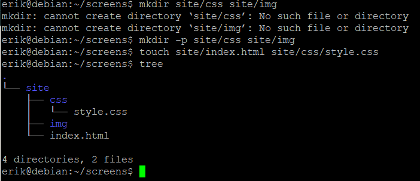
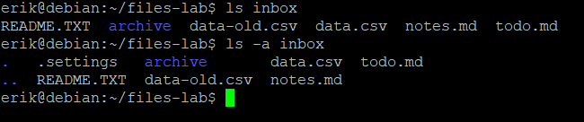
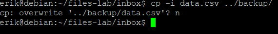
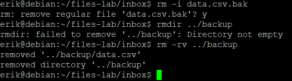
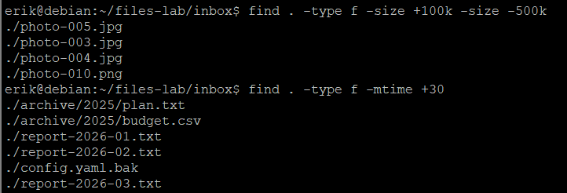
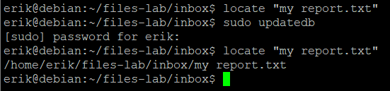

# Файлы, маски, поиск и справка · отчёт

ФИО: Кожемякин Эрик Романович<BR>
Группа: РПО-1<BR>
Дата: 11.10.2026<BR>
Среда: установленная Debian 13 (только консоль)

## Каталог site

Команды:

```bash
mkdir -p, touch, tree
```



Результат: Создана структура проекта site/ с вложенными папками css/ и img/, а также файлами index.html и style.css.

Почему mkdir без -p сообщил об ошибке.
> Команда mkdir по умолчанию не умеет создавать цепочки папок, если их родительский каталог (в данном случае site/) еще не существует. Флаг -p (parents) автоматически создает все недостающие промежуточные папки.

Вывод: Для создания вложенных структур каталогов за один раз всегда нужно использовать флаг -p.

## Учебный набор

Команды:

```bash
ls, ls -A inbox
```



Результат: Выведен список файлов в директории inbox, включая скрытые элементы конфигурации.

Какой файл виден только с ключом -A и почему.
> Файл .settings, потому что в Linux любые файлы и папки, название которых начинается с точки (.), считаются скрытыми. Ключ -a или -A заставляет команду ls отображать их.

Вывод: Стандартная команда ls скрывает системные файлы; для полной инспекции директории необходимо использовать ключ -a или -A.

## Копирование с вопросом

Команды:

```bash
cp -i data.csv ../backup/
```



Результат: Копирование файла было отменено пользователем (n), старая версия файла в папке backup осталась нетронутой.

Что сделает cp без -i, если файл уже есть.
> Команда cp без флага -i автоматически и без предупреждения перезапишет существующий файл файлом с тем же именем.

Вывод: Флаг -i (interactive) защищает от случайной потери данных при перезаписи файлов.

## Удаление каталога

Команды:

```bash
rm, rmdir, rm -rv
```



Результат: Успешно удален файл data.csv.bak и полностью очищена и удалена папка ../backup со всем её содержимым.

Чем rmdir отличается от rm -r.
> Команда rmdir может удалять только пустые каталоги, в то время как rm -r (recursive) удаляет каталог вместе со всем его содержимым (файлами и подпапками).

Вывод: Для безопасного удаления пустых папок подходит rmdir, а для полной очистки непустых директорий используется rm -r (или rm -rv для визуального контроля).

## Маски

Команды:

```bash
ls *.txt, ls photo-00[1-3].jpg, echo *.docx
```


Результат: Выведены имена всех текстовых файлов, все картинки, только photo-001 - photo-003 с расширением jpg, маска *.docx не раскрылась потому что таких файлов нет  

Кто раскрывает маску и что получает команда, если совпадений нет.
> Маску раскрывает bash, если совпадений нет команда получает маску без изменений.

Вывод: Надо учитывать что маску раскрывает bash. Если программе нужно передать именно маску ее надо экранировать

## Поиск find

Команды:

```bash
find -size, find -mtime
```



Результат: Все файлы размером от 100 до 500 киб и файлы старше 30 дней

Почему -size -1M не нашёл ни одного файла.
> Так как минимальное округленное значение для существующего файла — это уже 1M (а 1M не меньше 1M), под это условие попадают только абсолютно пустые файлы размером ровно 0 байт.

Вывод: В команде find нельзя использовать 1 в размере (хоть 1k хоть 1m...)

## Поиск locate

Команды:

```bash
locate, sudo updatedb, locate -e
```



Результат: Путь к файлу выведен только после updatedb

Почему locate выводит путь удалённого файла.
> Потому что locate не сканирует файловую систему, она берет путь из базы данных

Вывод: locate работает очень быстро, но может выдать неправильный результат 

## Справка

Команды:

```bash
man ls, поиск /sort by file size
```


Результат: Найден ключ -S 

Какой ключ сортирует по размеру и как вы его нашли.
> -S; нажал / и ввел текст для поиска

Вывод: С помощью man можно не только вывести документацию, но и делать поиск по документации

## Результат квеста

Команды:

```bash
tree ~/files-lab/sorted
```


Результат: Файлы распределены по каталогам

Сколько файлов в каждом подкаталоге.
> data - 2; docs - 7; images - 6; logs - 4

Вывод: Все файлы распределены логично

## Проверка

Команды:

```bash
bash ~/Downloads/files-lab-check.sh
```


Результат: Проверка пройдена

Итог проверки; какие пункты потребовали исправления.
> Все ок

Вывод: Все сделал правильно

## Ответы

Содержимое answers.txt:

```text
./archive/2025/plan.txt
./archive/2025/budget.csv
./data-old.csv
token=lab-only
ls -S sorted/images/
/etc/os-release
```

