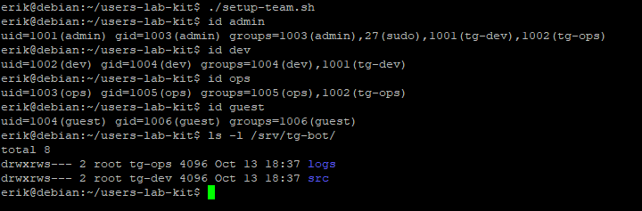
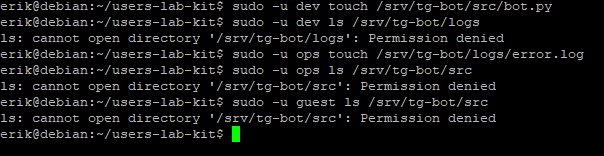

Для проекта Telegram-бота предлагается следующая модель доступа, разделяющая ответственность между разработчиками, операторами и системными администраторами.

### Модель доступа: Telegram-бот

**Каталоги проекта:**
1. `/srv/tg-bot/src` (код): группа `tg-dev`, права `2770` (`drwxrws---`)
2. `/srv/tg-bot/logs` (логи): группа `tg-ops`, права `2770` (`drwxrws---`)

#### Таблица ролей
| Роль | Учётная запись | Группы | Доступные каталоги | Может | Не может |
|:---|:---|:---|:---|:---|:---|
| **Admin** | `admin` | `sudo`, `tg-dev`, `tg-ops` | `/srv/tg-bot/` | Всё (администрирование) | — |
| **Developer** | `dev` | `tg-dev` | `/srv/tg-bot/src` | Писать/менять код | Менять логи |
| **Operator** | `ops` | `tg-ops` | `/srv/tg-bot/logs` | Читать/чистить логи | Менять код |
| **Guest** | `guest` | — | — | Ничего | Доступ к проекту |

Созданные пользователи и кталоги

### Таблица тестов доступа

| № | Пользователь | Команда | Ожидается | Получено |
|:---|:---|:---|:---|:---|
| 1 | `dev` | `sudo -u dev touch /srv/tg-bot/src/bot.py` | Успешно | |
| 2 | `dev` | `sudo -u dev ls /srv/tg-bot/logs` | Отказано | |
| 3 | `ops` | `sudo -u ops touch /srv/tg-bot/logs/error.log` | Успешно | |
| 4 | `ops` | `sudo -u ops ls /srv/tg-bot/src` | Отказано | |
| 5 | `guest` | `sudo -u guest ls /srv/tg-bot/src` | Отказано | |

Результаты тестов

