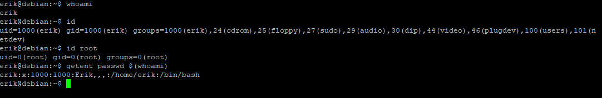
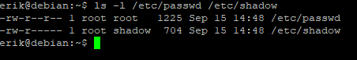
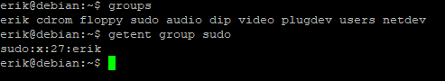
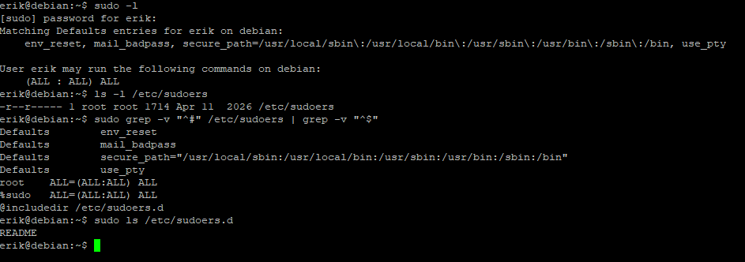
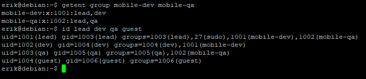
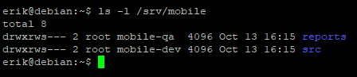
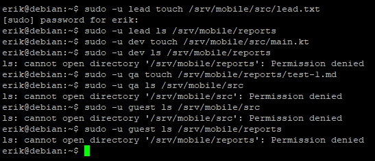
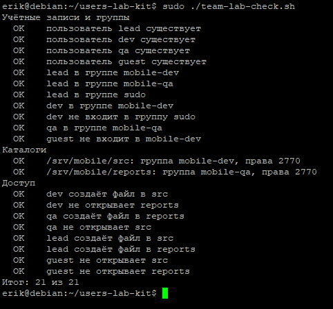
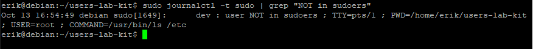

# Пользователи, группы и sudo · отчёт

ФИО: Кожемякин Эрик Романович<BR>
Группа: РПО-1<BR>
Дата: 12.10.2026<BR>
Среда: установленная Debian 13 (только консоль)

## Учётная запись

Команды:

```bash
id, getent passwd $(whoami)
```



Результат: Команды показывают, что текущий пользователь — `erik` с UID 1000 и GID 1000. Он входит в группу `sudo`, что дает ему права администратора. Пользователь `root` имеет UID 0. Информация из `/etc/passwd` подтверждает домашнюю директорию `/home/erik` и оболочку `/bin/bash`.

Подпишите семь полей своей строки /etc/passwd.
> `erik` (имя пользователя) : `x` (пароль зашифрован в shadow) : `1000` (UID) : `1000` (GID) : `Erik,,,` (комментарий/GECOS) : `/home/erik` (домашняя директория) : `/bin/bash` (оболочка командной строки).

Вывод: Идентификация пользователя происходит по UID, а права доступа еще определяются принадлежностью к группам. Файл `/etc/passwd` является общедоступным для чтения, но не содержит самих паролей.

## passwd и shadow

Команды:

```bash
ls -l /etc/passwd /etc/shadow
```



Результат: Файл `/etc/passwd` имеет права `644` (чтение для всех), а `/etc/shadow` — `640` (доступ только для владельца root и группы shadow).

Почему shadow закрыт для остальных пользователей.
> Файл `/etc/shadow` содержит хэши (зашифрованные представления) паролей всех пользователей системы. Если бы он был открыт для всех, любой пользователь мог бы скопировать его и попытаться подобрать пароли методом перебора (брутфорс), что представляет критическую угрозу безопасности системы.

Вывод: Разграничение прав доступа к файлам `/etc/passwd` и `/etc/shadow` является базовым принципом безопасности Linux, позволяющим хранить конфиденциальную информацию о паролях в защищенном месте.

## Группы

Команды:

```bash
groups, getent group sudo
```



Результат: Команда `groups` показала список всех групп, в которые входит пользователь `erik`. `getent group sudo` подтвердила, что пользователь `erik` является членом группы `sudo`.

Где основная группа, где дополнительные.
> Основная (первичная) группа — `erik` (имеет тот же ID, что и пользователь). Дополнительные (вторичные) группы — это все остальные, перечисленные в выводе: `cdrom`, `floppy`, `sudo`, `audio`, `dip`, `video`, `plugdev`, `users`, `netdev`.

Вывод: Дополнительные группы расширяют права пользователя (например, доступ к аудиоустройствам или управление сетью), не меняя при этом основную рабочую группу.

## Правила sudo

Команды:

```bash
sudo -l
```



Результат: Команда `sudo -l` показала, что пользователю `erik` разрешено выполнять любые команды от имени любого пользователя и группы. Файл `/etc/sudoers` защищен (права `440`).

Какое правило даёт вам права администратора.
> Правило: `%sudo ALL=(ALL:ALL) ALL`.
Оно означает, что любая группа (знак `%` указывает на группу), имеющая название `sudo`, может выполнять любые команды (`ALL`) от имени любого пользователя или группы (`ALL:ALL`) на текущем хосте (`ALL`). Так как мой пользователь входит в группу `sudo`, он наследует эти права.


Вывод: Можно повышать привилегии через `sudo`. Управление правами доступа осуществляется через конфигурационный файл `/etc/sudoers`, который позволяет гибко настраивать возможности пользователей без необходимости давать им пароль суперпользователя `root`.

## Команда mobile-app

Команды:

```bash
getent group …, id lead dev qa guest
```



Результат: Команды `getent` и `id` подтвердили успешное создание групп `mobile-dev` и `mobile-qa`, а также корректное распределение пользователей по группам в соответствии с заданием. 

Совпадают ли группы со схемой ролей.
> Да, группы полностью соответствуют схеме:
*   `lead` состоит в `mobile-dev`, `mobile-qa` и `sudo`.
*   `dev` состоит в `mobile-dev`.
*   `qa` состоит в `mobile-qa`.
*   `guest` состоит только в своей личной группе.


Вывод: Cистемные записи пользователей и групп корректно отражают заданную структуру прав доступа, что является необходимым условием для настройки разграничения прав на уровне файловой системы.

## Каталоги проекта

Команды:

```bash
ls -l /srv/mobile
```



Результат: Команда `ls -l` показала, что каталоги `/srv/mobile/src` и `/srv/mobile/reports` принадлежат соответствующим группам (`mobile-dev` и `mobile-qa`) и имеют биты прав `2770`.

Что означает каждая цифра в 2770.

*   **2** (Special bit/setgid): гарантирует, что новые файлы, созданные в этом каталоге, будут наследовать группу каталога, а не основную группу создавшего их пользователя.
*   **7** (Владелец): права на чтение, запись и исполнение (rwx).
*   **7** (Группа): права на чтение, запись и исполнение для членов группы (rwx).
*   **0** (Остальные): права отсутствуют (---).


Вывод: Использование `setgid` (бита 2) критически важно для командной работы, так как это позволяет пользователям внутри одной группы совместно редактировать файлы без проблем с правами доступа.

## Тесты доступа

Команды:

```bash
sudo -u … ls / touch
```



Результат: 

Таблица тестов подтвердила правильность настройки:
*   `lead` имеет доступ ко всему.
*   `dev` может работать в `src`, но не видит `reports`.
*   `qa` может работать в `reports`, но не видит `src`.
*   `guest` полностью ограничен и не имеет доступа к директориям проекта.


Результаты таблицы тестов доступа.

| Пользователь | Доступ к src | Доступ к reports |
| :--- | :--- | :--- |
| **lead** | Да | Да |
| **dev** | Да | Нет |
| **qa** | Нет | Да |
| **guest** | Нет | Нет |


Вывод: Настройка прав через группы и права доступа каталогов успешно ограничивает область видимости файлов для различных ролей, обеспечивая безопасность данных.

## Проверка

Команды:

```bash
sudo bash team-lab-check.sh
```



Результат: Проверка полностью пройдена

Итог проверки; какие пункты потребовали исправления.

Вывод: Все сделал правильно

## Отказ sudo в журнале

Команды:

```bash
journalctl -t sudo | grep "NOT in sudoers"
```



Результат: Журнал событий `journalctl` зафиксировал попытку несанкционированного использования `sudo`.

Кто, когда и какую команду пытался выполнить.
> Пользователь `dev` 13 октября в 16:54:49 пытался выполнить команду `ls /etc` с правами суперпользователя (`sudo`), но получил отказ, так как он не входит в группу `sudo` или файл `sudoers`.

Вывод: Системный журнал является важным инструментом аудита безопасности. Он позволяет администратору отслеживать попытки несанкционированного повышения привилегий в системе.

## Почему постоянная работа под root опасна

1.  **Риск случайного удаления или повреждения системы:** Ошибочная команда (например, с опечаткой), введенная от `root`, может удалить критически важные системные файлы, так как у суперпользователя нет ограничений прав.
2.  **Уязвимость перед вредоносным ПО:** Если вы запустите скрипт или программу с правами `root`, она получит полный контроль над системой, сможет установить бэкдоры, украсть пароли или зашифровать данные. При работе под обычным пользователем вредоносный код ограничен правами текущей учетной записи.
3.  **Отсутствие ответственности (отслеживаемости):** Если в системе работают несколько человек под учетной записью `root`, невозможно определить, кто именно совершил то или иное действие, которое привело к сбою системы. Работа под личными учетными записями обеспечивает прозрачность логов.

