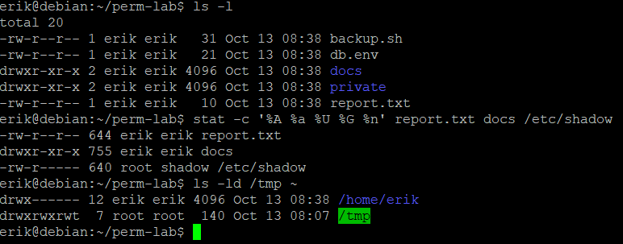
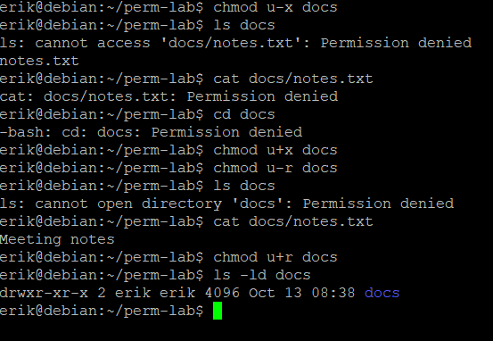
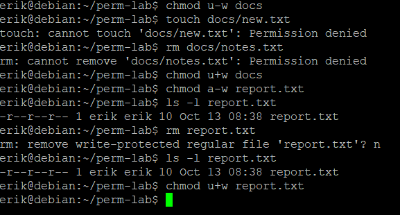
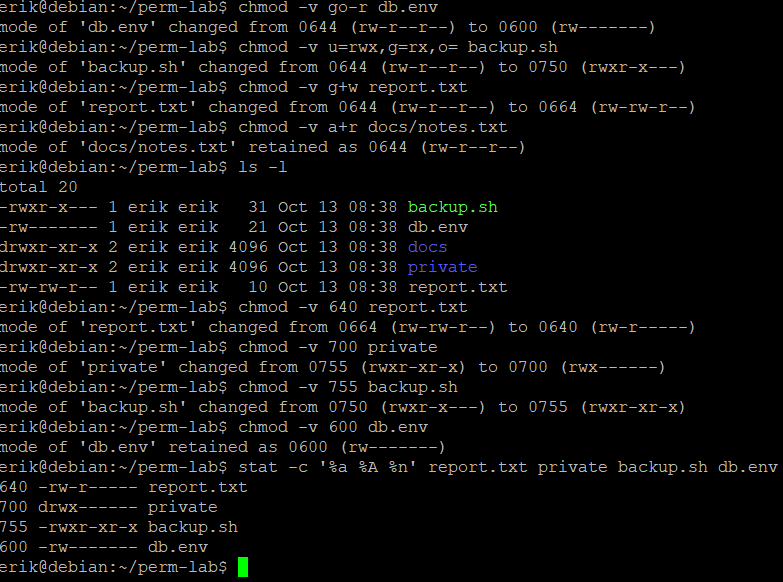
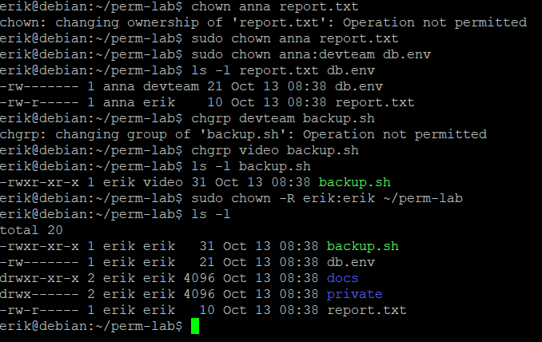
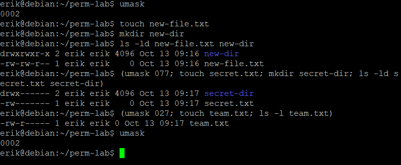
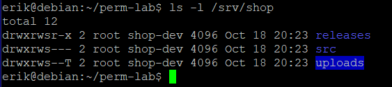
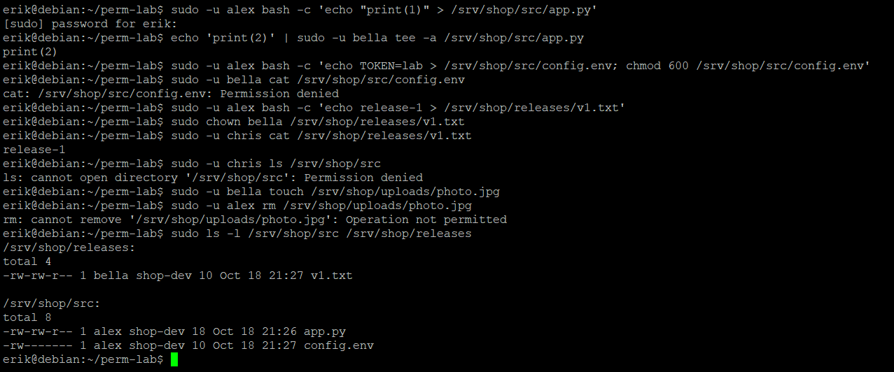
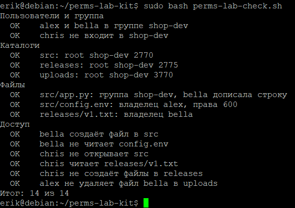

# Права доступа, владельцы и umask · отчёт

ФИО: Кожемякин Эрик Романович<BR>
Группа: РПО-1<BR>
Дата: 18.10.2026<BR>
Среда: установленная Debian 13 (только консоль)

## Строка ls -l

Команды:

```bash
ls -l, stat -c …
```



Результат:
> Определены атрибуты, права и владельцы файлов и каталогов с помощью `ls -l`, `stat` и `ls -ld`. Обычные файлы по умолчанию имеют права `644` (`-rw-r--r--`), каталог `docs` — `755` (`drwxr-xr-x`), системный файл `/etc/shadow` — `640` (доступен только суперпользователю `root` и группе `shadow`). Каталог `/tmp` имеет специальный sticky bit (`t`), а домашний каталог `/home/erik` защищён правами `700` (`drwx------`).

Подпишите поля одной строки: тип, три тройки, владелец, группа.

Разбор строки: `drwxr-xr-x 2 erik erik 4096 Oct 13 08:38 docs`
* `d` — **тип файла**: каталог (directory). Для обычного файла здесь символ `-`.
* `rwx` — **первая тройка**: права владельца файла (user/owner) — чтение (`r`), запись (`w`), исполнение/вход (`x`).
* `r-x` — **вторая тройка**: права группы-владельца (group) — чтение (`r`) и вход (`x`), запись запрещена (`-`).
* `r-x` — **третья тройка**: права остальных пользователей (others) — чтение (`r`) и вход (`x`), запись запрещена (`-`).
* `erik` (первый) — **владелец** (user): пользователь `erik`.
* `erik` (второй) — **группа-владелец** (group): группа `erik`.

Вывод:
> Утилиты `ls -l` и `stat` позволяют детально исследовать права доступа в Linux. Права строго разделены на три независимые категории субъектов (владелец, группа, остальные), а первый символ метаданных всегда указывает на тип сущности файловой системы (`-` — файл, `d` — каталог).


## Каталог без x и без r

Команды:

```bash
chmod u-x / u-r docs, ls, cat
```



Результат:
> Экспериментально проверено разделение прав `r` и `x` на каталоге. При отсутствии `x` невозможно зайти в каталог (`cd`), прочитать метаданные файлов или открыть их по пути (`cat docs/notes.txt`). При отсутствии `r`, но наличии `x`, нельзя просмотреть список файлов (`ls docs`), однако можно напрямую обращаться к файлу (`cat docs/notes.txt`), если его точное имя известно заранее.

Объясните каждую ошибку: что запрещено без x и без r.
1. `ls: cannot access 'docs/notes.txt': Permission denied` (при `u-x`): у каталога есть право `r`, поэтому имя файла прочитано из каталога, но для вызова системного вызова `stat()` (получения атрибутов/inode файла) требуется право прохода `x`. Без `x` доступ к атрибутам заблокирован.
2. `cat: docs/notes.txt: Permission denied` (при `u-x`): для разрешения любого пути ядро должно выполнить трассировку всех каталогов в пути (directory traversal). Без бита `x` на каталоге `docs` пройти сквозь него к файлу нельзя.
3. `-bash: cd: docs: Permission denied` (при `u-x`): переход в директорию требует права исполнения (`x`), так как это операция смены контекста/входа в директорию.
4. `ls: cannot open directory 'docs': Permission denied` (при `u-r`): право `r` на директории отвечает исключительно за чтение списка содержащихся в ней имен (директорных записей). Без бита `r` утилита `ls` не может открыть директорию и получить список файлов.


Вывод:
> Для директорий права имеют принципиально иной смысл, нежели для файлов:
* `r` (read) — право **читать список записей** в директории (видеть имена).
* `x` (execute) — право **прохода/навигации** (traversal) через директорию, входа (`cd`) и доступа к дескрипторам (inode) файлов внутри неё. Полноценная работа с каталогом требует наличия обоих прав (`r-x`).


## Удаление и право w

Команды:

```bash
chmod u-w docs, rm
```



Результат:
> При снятии бита записи с каталога (`chmod u-w docs`) создание файлов (`touch`) и их удаление (`rm`) внутри него запрещены. Снятие прав на запись с самого файла (`chmod a-w report.txt`) не запрещает его удаление из родительского каталога, где есть право `w`; утилита `rm` лишь выводит предупреждающий интерактивный запрос `remove write-protected regular file?`.


Почему удаление файла решает каталог, а не файл.
> Каталог в Linux представляет собой таблицу, сопоставляющую имена файлов с номерами их индексных дескрипторов (inode). 
* Создание или удаление файла — это модификация **содержимого каталога** (добавление или исключение строчки со связью «имя -> inode» и декремент счетчика ссылок inode).
* Сам файл и его права (`rwx`) отвечают исключительно за доступ к содержимому (данным) этого файла.
* Следовательно, возможность удалить файл определяется наличием права на запись (`w`) и исполнение (`x`) у **родительского каталога**, а не правами самого файла.


Вывод:
> Право на удаление файла зависит от прав на директорию, в которой он размещён. Защита файла от записи (`-r--r--r--`) предотвращает изменение его содержимого, но не защищает его от удаления владельцем каталога.

## chmod буквами и числом

Команды:

```bash
chmod -v …
```



Результат:
> Отработаны символьный (буквенный) и абсолютный (числовой/восьмеричный) способы изменения прав командой `chmod`. С помощью флага `-v` отслежены изменения и проверены итоговые биты прав через `stat`.


Переведите три своих примера из букв в число и обратно.
1. `rwxr-x---` (пользователь: `rwx`, группа: `r-x`, остальные: `---`)
   * Числовой вид: `750`.
2. `rw-rw-r--`
   * Числовой вид: `664`
3. Числовой вид: `640`
   * Буквенный вид: `rw-r-----`


Вывод:
> Символьный синтаксис удобен для относительного добавления/снятия конкретных прав (`+`, `-`) без перезаписи остальных, а числовой (восьмеричный) синтаксис эффективен для быстрого задания фиксированного набора прав сразу для всех трёх триад.


## Владелец и группа

Команды:

```bash
chown, chgrp
```



Результат:
> Попытка сменить владельца файла от обычного пользователя завершилась ошибкой `Operation not permitted`. Смена пользователя (`chown`) успешно выполнена через `sudo`. Смена группы (`chgrp`) обычным пользователем допустима только на те группы, членом которых он сам является (смена на `video` прошла успешно, на `devteam` — отклонена). В конце исходные права рекурсивно восстановлены командой `sudo chown -R erik:erik ~/perm-lab`.

Почему chown без sudo запрещён, а chgrp на свою группу разрешён.
1. **Запрет `chown` для обычных пользователей:** Это критическое требование безопасности (POSIX). Если бы пользователи могли передавать владение файлами (`give away`), они могли бы:
   * Превышать дисковые квоты других пользователей, подбрасывая им тяжелые файлы.
   * Подставлять других пользователей (например, создавать нелегальные/вредоносные файлы от чужого имени).
   * Терять контроль над файлом без возможности вернуть его обратно. Поэтому смена UID закреплена исключительно за суперпользователем (`root` / `CAP_CHOWN`).
2. **Разрешение `chgrp` на свою группу:** Пользователь имеет право делегировать совместный доступ к своему файлу тем рабочим группам, в которых он официально состоит. При этом он не может назначить чужую группу, так как это нарушило бы модель изоляции прав.

Вывод:
> Смена владельца файла — привилегированная операция, доступная только суперпользователю. Обычный пользователь может управлять только привязкой файла к группам, в которые сам входит.

## umask

Команды:

```bash
umask, (umask 027; …)
```



Результат:
> Продемонстрировано влияние маски создания файлов `umask` на результирующие права новых объектов. При стандартной маске `0002` файлы создаются с правами `664`, каталоги — `775`. Использование подоболочки `(umask ...)` позволило локально применить маски `077` (создание приватных файлов `600`/каталогов `700`) и `027` (файлы `640`), не затрагивая глобальную маску сессии (`0002`).

Права файла и каталога при маске 0027 — расчёт по тройкам.
> Базовые права ядра до применения маски:
* Для файлов: `666` (`rw-rw-rw-`) — файлы по умолчанию создаются без бита исполнения `x`.
* Для каталогов: `777` (`rwxrwxrwx`) — каталогам необходим бит `x` для навигации.

Маска `027` вычитает права (побитовая операция `результат = базовые & ~маска`):
* **Тройка владельца (User):**
  * Маска: `0` (ничего не забирается).
  * Каталог: $7 - 0 = 7$ (`rwx`).
  * Файл: $6 - 0 = 6$ (`rw-`).
* **Тройка группы (Group):**
  * Маска: `2` (забирается бит записи `w`, вес 2).
  * Каталог: $7 - 2 = 5$ (`r-x`).
  * Файл: $6 - 2 = 4$ (`r--`).
* **Тройка остальных (Others):**
  * Маска: `7` (забираются все права: `r`, `w`, `x`, вес $4+2+1=7$).
  * Каталог: $7 - 7 = 0$ (`---`).
  * Файл: $6 - 6 = 0$ (`---`).
* Результирующие права каталога: **`750`** (`drwxr-x---`).
* Результирующие права файла: **`640`** (`-rw-r-----`).

Вывод:
> `umask` определяет фильтр запретов при создании новых файлов и каталогов. С помощью `umask 027` обеспечивается безопасная групповая разработка: владелец имеет полный доступ, группа может читать/входить, а посторонним пользователям доступ полностью закрыт.


## Каталоги проекта

Команды:

```bash
ls -l /srv/shop
```



Результат:
> Создана инфраструктура проекта `/srv/shop` со специальными правами:
* `/srv/shop/src` (`2770`): SGID-бит (`s`), доступ только для владельца и группы `shop-dev`.
* `/srv/shop/releases` (`2775`): SGID-бит (`s`), чтение и исполнение доступны также и остальным (`others`).
* `/srv/shop/uploads` (`3770`): одновременно установлены SGID-бит (`s`) и Sticky bit (`T`).


Что означает каждая буква в drwxrws--T.
* `d` — тип файла: **каталог** (directory).
* **Первая тройка (`rwx`) — права владельца (`root`):**
  * `r` — чтение (просмотр списка файлов).
  * `w` — запись (создание и удаление файлов).
  * `x` — исполнение (вход в каталог).
* **Вторая тройка (`rws`) — права группы (`shop-dev`):**
  * `r` — чтение файлов каталога группой.
  * `w` — создание и модификация структуры каталога группой.
  * `s` — **SGID (Set Group ID) на каталоге**: все вновь создаваемые файлы и подкаталоги будут автоматически наследовать группу-владельца родительской папки (`shop-dev`), а не первичную группу создавшего их пользователя. Символ строчный (`s`), так как стандартный бит `x` для группы также включен.
* **Третья тройка (`--T`) — права остальных пользователей (`others`):**
  * `-` — чтение запрещено.
  * `-` — запись запрещена.
  * `T` — **Sticky bit (бит ограничения удаления)**: удалять или переименовывать файлы в каталоге могут только владелец этого файла, владелец каталога или `root`. Буква **заглавная (`T`)**, потому что стандартный бит исполнения `x` для остальных отключен (`-` + `t` = `T`).

Вывод:
> Комбинация SGID и Sticky-бита позволяет организовать защищённую среду для совместной командной работы: SGID гарантирует наследование рабочей группы проекта, а Sticky-бит предотвращает случайное или злонамеренное удаление чужих файлов участниками группы.

## Тесты доступа

Команды:

```bash
sudo -u … cat / ls / rm
```



Результат:
> Практически протестированы сценарии разграничения доступа для пользователей `alex`, `bella` (члены `shop-dev`) и `chris` (не входит в `shop-dev`). Наследование группы через SGID сработало на всех новых файлах (`shop-dev`). Sticky-бит в `/uploads` заблокировал удаление чужого файла, а мандаты `others` корректно изолировали каталог `src`.

Какой бит или право объясняет каждый результат.
1. **`echo 'print(2)' | sudo -u bella tee -a /srv/shop/src/app.py` — успешно:**
   * *Объяснение:* Файл создан пользователем `alex`, но благодаря SGID каталога его группа стала `shop-dev`. Права файла `664` содержат бит **`w` для группы**. Пользователь `bella` входит в `shop-dev`, поэтому имеет право на запись в файл.
2. **`sudo -u bella cat /srv/shop/src/config.env` — ошибка `Permission denied`:**
   * *Объяснение:* На файле установлены права `600` (`-rw-------`), т.е. права чтения для группы и остальных сняты (`g-r`, `o-r`). Несмотря на то, что `bella` находится в каталоге и в группе `shop-dev`, **отсутствие права `r` у группы на самом файле** блокирует чтение.
3. **`sudo -u chris cat /srv/shop/releases/v1.txt` — успешно:**
   * *Объяснение:* Каталог `releases` имеет права `2775` (бит **`o+rx`** разрешает проход посторонним), а файл `v1.txt` имеет права `664` (бит **`o+r`** разрешает чтение для остальных). Пользователь `chris` попадает в категорию `others` и успешно читает файл.
4. **`sudo -u chris ls /srv/shop/src` — ошибка `Permission denied`:**
   * *Объяснение:* Каталог `src` имеет права `2770` (`---` для остальных). Так как `chris` не входит в группу `shop-dev`, он подпадает под категорию `others`, где **сняты биты `r` и `x`**. Доступ к содержимому закрыт.
5. **`sudo -u alex rm /srv/shop/uploads/photo.jpg` — ошибка `Operation not permitted`:**
   * *Объяснение:* Каталог `uploads` имеет права `3770`, где установлен **Sticky bit** (бит `1000` / `T`). В каталоге со sticky-битом удалить файл может только его владелец (`bella`) или `root`. Пользователь `alex` не является владельцем файла, поэтому удаление запрещено.
6. **Группа `shop-dev` у файлов `app.py`, `config.env`, `v1.txt`:**
   * *Объяснение:* Сработал **SGID-бит** (`2000` / `s`) родительских каталогов, который автоматически подставляет группу директории вместо основной группы создателя файла.

Вывод:
> Корректно настроенные базовые права UNIX вкупе со специальными битами (SGID и Sticky bit) позволяют гибко регулировать групповую безопасность: обеспечивать совместную модификацию кода внутри команды, скрывать приватные конфигурации, предоставлять публичный read-only доступ и предотвращать деструктивные действия пользователей в общих каталогах.

## Проверка

Команды:

```bash
sudo bash perms-lab-check.sh
```



Результат: Проверка прошла успешно.

Итог проверки; какие пункты потребовали исправления.
> Все пункты проверки пройдены, исправления не понадобились

Вывод:
> Задание выполнено
