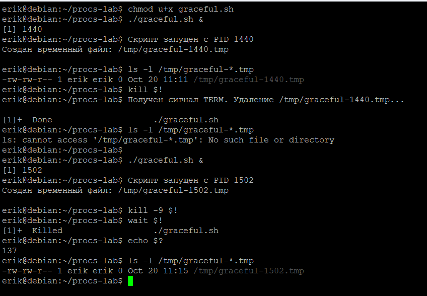
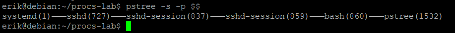

# Работа с graceful.sh

## Запуск и отсановка разными способами



### 1. Завершение по сигналу TERM (штатная очистка)

Команды:
```bash
./graceful.sh &
ls -l /tmp/graceful-*.tmp
kill $!
ls -l /tmp/graceful-*.tmp
```

**Результат:**  

Процесс с PID `1440` успешно перехватил сигнал `SIGTERM` с помощью встроенной команды `trap`. Была выполнена процедура корректного завершения (graceful shutdown): скрипт удалил свой временный файл `/tmp/graceful-1440.tmp` и штатно вышел с кодом `0` (статус `Done` в выводе оболочки). Повторный вызов `ls` подтвердил отсутствие файла на диске.


### 2. Принудительное завершение по сигналу KILL

Команды:
```bash
./graceful.sh &
kill -9 $!
wait $!
echo $?
ls -l /tmp/graceful-*.tmp
```

**Результат:**  
Процесс с PID `1502` был немедленно уничтожен сигналом `SIGKILL` (`kill -9`). Команда `wait $!` вернула статус `Killed`, а переменная `$?` зафиксировала код завершения **`137`** ($128 + 9$). Временный файл `/tmp/graceful-1502.tmp` остался в файловой системе, так как скрипт не успел выполнить очистку.

## Объяснение разницы между TERM и KILL

Сигнал `SIGTERM` передаётся процессу, позволяя ему перехватить событие через `trap` и корректно освободить ресурсы перед выходом с кодом `0`. Сигнал `SIGKILL` обрабатывается исключительно ядром операционной системы — его невозможно перехватить или проигнорировать, поэтому процесс уничтожается мгновенно без выполнения кода очистки. По этой причине код возврата при `SIGKILL` равен `137` ($128 + 9$), а временный файл остаётся брошенным на диске.

## 3. Цепочка процессов от PID 1 до оболочки

Команда:
```bash
pstree -s -p $$
```


**Описание каждого звена цепочки:**

1. **`systemd (PID 1)`** — корневой процесс инициализации операционной системы (init), предок всех процессов в пространстве пользователя. Запускает и контролирует системные службы.
2. **`sshd (PID 727)`** — главный системный демон OpenSSH, работающий от пользователя `root` и непрерывно слушающий порт 22 на предмет входящих сетевых подключений.
3. **`sshd-session (PID 837)`** — супервизор конкретной SSH-сессии (работает с повышенными привилегиями для аутентификации и разделения прав).
4. **`sshd-session (PID 859)`** — непривилегированный дочерний процесс сессии OpenSSH, запущенный от имени пользователя `erik`, обеспечивающий криптографический туннель и обмен данными с терминалом.
5. **`bash (PID 860)`** — интерактивная командная оболочка текущего пользователя, в которой выполняются команды лабораторной работы.
6. **`pstree (PID 1532)`** — утилита, порождённая текущей оболочкой `bash` для построения и вывода дерева процессов.
