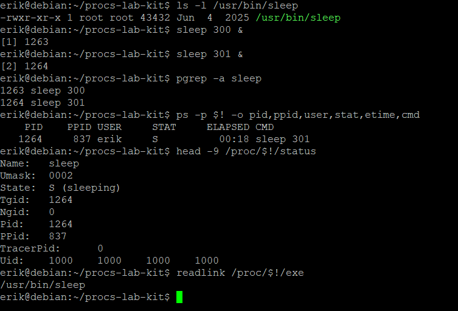
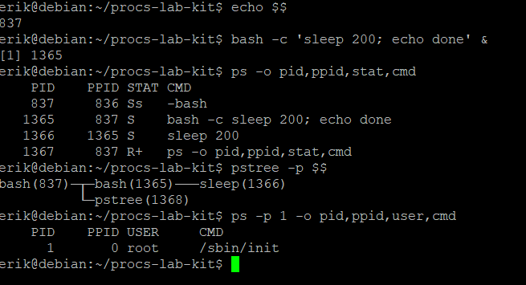
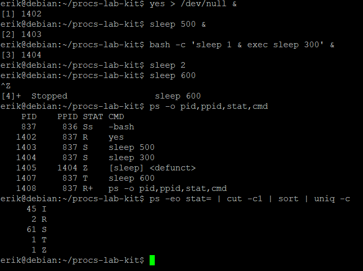
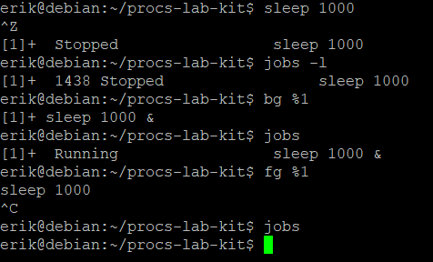
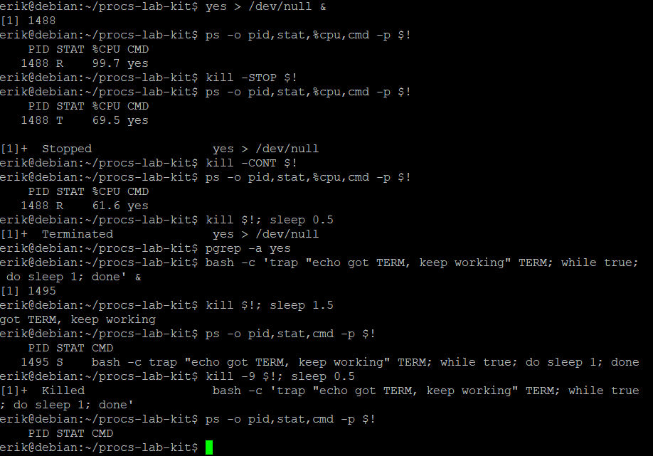
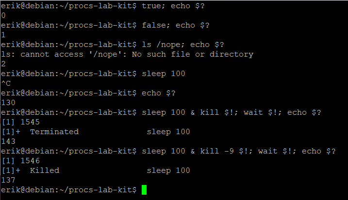
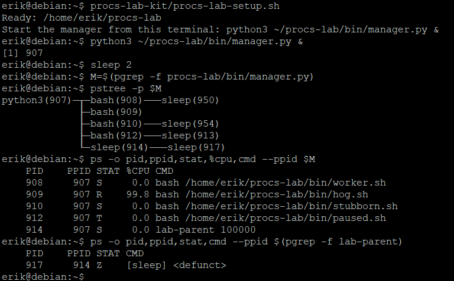
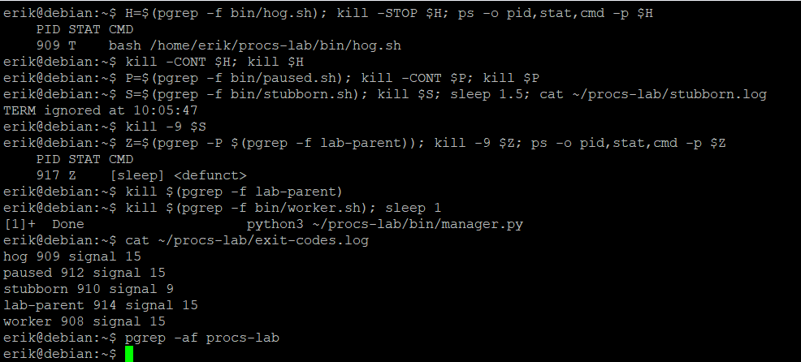
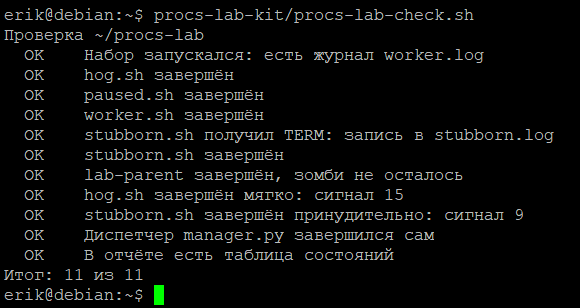

# Процессы: PID, состояния и сигналы · отчёт

ФИО: Кожемякин Эрик Романович<BR>
Группа: РПО-1<BR>
Дата: 13.10.2026<BR>
Среда: установленная Debian 13 (только консоль)

## Программа и процесс

Команды:

```bash
sleep 300 &, pgrep -a, /proc/PID/status
```



Результат:
* **PID (Process ID):** `1264` — уникальный идентификатор процесса последнего запущенного задания (`$!`).
* **PPID (Parent Process ID):** `837` — идентификатор родительского процесса (интерактивной оболочки `-bash`).
* **Состояние (STAT / State):** `S` (`sleeping`) — процесс находится в прерываемом сне (ожидает события таймера ядра).
* **Символическая ссылка исполняемого файла:** `/proc/1264/exe` указывает на `/usr/bin/sleep`.


Подпишите PID, PPID и состояние; чем процесс отличается от файла программы:

**Программа** — это статический пассивный исполняемый файл, хранящийся на диске (в данном случае `/usr/bin/sleep` размером 43 432 байта), содержащий скомпилированный машинный код и данные.  
**Процесс** — это активный экземпляр исполняемой программы в оперативной памяти, управляемый ядром ОС. Процесс обладает собственным адресным пространством, уникальным идентификатором (PID), контекстом выполнения (регистры процессора, стек, файловые дескрипторы) и текущим состоянием. Из одного файла программы можно запустить множество изолированных процессов одновременно (что подтверждают параллельно запущенные процессы с PID `1263` и `1264`).

Вывод:
> В ходе эксперимента изучены механизмы запуска фоновых задач и получение информации о процессах через утилиты `pgrep`, `ps`, а также через виртуальную файловую систему `/proc`. Подтверждено, что программа является статическим шаблоном на накопителе, а процесс — динамическим объектом ядра в оперативной памяти.


## Дерево процессов

Команды:

```bash
echo $$, pstree -p $$
```



Результат: 

* Текущий командный процессор: PID `837`.
* Порожденная фоновая оболочка: PID `1365` (PPID `837`).
* Команда, запущенная внутри оболочки: PID `1366` (PPID `1365`).
* Корень всего дерева процессов: PID `1` (`/sbin/init` с PPID `0`).

Подпишите цепочку от оболочки до sleep: кто чей родитель.

1. `bash (PID 837)` является **родителем** для дочернего интерпретатора `bash (PID 1365)`.
2. `bash (PID 1365)` является **родителем** для дочерней команды `sleep 200 (PID 1366)`.  
Таким образом, цепочка наследования имеет вид:  
`/sbin/init (1)` → ... → `bash (837)` → `bash (1365)` → `sleep (1366)`.

Вывод: 
> Все процессы в ОС Linux образуют строгую иерархическую древовидную структуру с общим корнем в виде процесса инициализации `init/systemd` (PID 1). Каждый дочерний процесс создается системным вызовом `fork()` и хранит ссылку на создавший его родительский процесс (PPID).

## Состояния

Команды:

```bash
yes &, sleep &, Ctrl+Z, ps -o stat
```



Результат: 

В выводе зафиксированы ключевые состояния процессов:
* PID `1402`: `R` (`yes`)
* PID `1403`, `1404`: `S` (`sleep`)
* PID `1407`: `T` (`sleep 600`)
* PID `1405`: `Z` (`[sleep] <defunct>`)

Объясните каждое из четырёх состояний и почему появился зомби.

1. **R (Running / Runnable):** процесс выполняется на процессоре прямо сейчас или находится в очереди готовности планировщика задач (процесс `yes` непрерывно вычисляет цикл вывода).
2. **S (Interruptible Sleep):** прерываемый сон; процесс ожидает события, таймера или завершения операции ввода-вывода, не потребляя процессорное время, и готов немедленно проснуться при поступлении сигнала.
3. **T (Stopped):** процесс принудительно приостановлен сигналом управления задачами (в данном случае получен сигнал `SIGTSTP` через комбинацию клавиш `Ctrl+Z`). Он не получает кванты времени CPU, пока не получит сигнал `SIGCONT`.
4. **Z (Zombie):** завершившийся процесс. Он освободил память и дескрипторы, но запись о нем в таблице процессов ядра сохраняется до тех пор, пока родитель не прочитает код его завершения.

**Почему появился зомби (PID 1405):**  
Команда `bash -c 'sleep 1 & exec sleep 300'` сначала породила фоновый дочерний процесс `sleep 1` (PID 1405), а затем сразу заменила тело родительской оболочки на бинарник `sleep 300` (PID 1404) с помощью системного вызова `exec`. Программа `sleep` не содержит логики обработки сигналов `SIGCHLD` и не вызывает системный вызов `wait()`/`waitpid()` для сторонних процессов. Когда `sleep 1` завершился спустя одну секунду, его код завершения некому было прочитать, и он остался в состоянии `defunct` (зомби).


Вывод: 
> Жизненный цикл процесса описывается конечным автоматом состояний ядра. Некорректная архитектура взаимодействия родительского и дочернего процессов (отсутствие сбора кодов завершения через `wait`) приводит к утечке записей в таблице процессов (зомби).


## Фон и передний план

Команды:

```bash
Ctrl+Z, jobs -l, bg, fg
```



Результат: 

Продемонстрировано полное переключение процесса `sleep 1000` (PID `1438`) между режимами переднего плана (foreground), остановки (stopped) и фонового выполнения (background) с последующим прерыванием.

Что делает с заданием каждое действие.

1. **`Ctrl+Z`:** генерирует терминальный сигнал `SIGTSTP` (Terminal Stop), временно приостанавливая процесс переднего плана, переводит его в состояние `Stopped` (`T`) и возвращает управление интерактивной оболочке.
2. **`jobs -l`:** запрашивает у встроенного диспетчера оболочки список активных задач сессии с указанием их номеров заданий (`[1]`), PID (`1438`), статуса (`Stopped`) и вызвавшей команды.
3. **`bg %1`:** отправляет остановленному заданию №1 сигнал `SIGCONT`, возобновляя его выполнение, и переводит его в фоновый режим (`background`, эквивалентно запуску с `&`), освобождая терминал для ввода других команд.
4. **`fg %1`:** возвращает фоновую задачу №1 на передний план (`foreground`), подключая её к потокам терминала (stdin/stdout) и блокируя ввод шелла до её завершения.
5. **`Ctrl+C`:** посылает текущему активному процессу переднего плана терминальный сигнал прерывания `SIGINT` (код 2), завершая его выполнение.

Вывод: 
> Механизм управления заданиями (Job Control) оболочки позволяет гибко перераспределять доступ к терминалу между параллельно выполняющимися задачами, приостанавливать их и возвращать к работе без потери контекста.


## STOP, CONT и trap

Команды:

```bash
kill -STOP, kill -CONT, trap
```



Результат: 

* Сигнал `SIGSTOP` перевел процесс `1488` из `R` в `T`, сняв вычислительную нагрузку с CPU.
* Сигнал `SIGCONT` вернул процесс `1488` в состояние `R`.
* Процесс `1495` при получении `SIGTERM` выполнил перехваченное действие `echo got TERM, keep working` и остался активным (`STAT S`).
* Сигнал `SIGKILL` (`kill -9`) окончательно уничтожил процесс `1495`.

Почему процесс пережил TERM и не пережил KILL.

* Сигнал **SIGTERM (15)** — это сигнал мягкого запроса на завершение. Он является перехватываемым: операционная система передает его обработку в пространство пользователя, если процесс зарегистрировал свой обработчик с помощью команды `trap` (или системного вызова `sigaction`). Процесс перехватил этот сигнал, вывел сообщение в консоль и продолжил выполнение основного цикла.
* Сигнал **SIGKILL (9)** — это сигнал безусловного уничтожения. В архитектуре Linux ядро принципиально **не позволяет** процессам перехватывать, блокировать или игнорировать сигналы `SIGKILL` и `SIGSTOP`. Обработка `SIGKILL` выполняется непосредственно ядром ОС, которое мгновенно прекращает исполнение процесса и освобождает его ресурсы.

Вывод: 
> Процессы могут кастомизировать реакцию на большинство стандартных сигналов ОС для корректного освобождения ресурсов (graceful shutdown), однако ядро оставляет за администратором гарантированные рычаги управления (`SIGKILL`, `SIGSTOP`), перехват которых технически невозможен.

## Коды завершения

Команды:

```bash
echo $?, wait $!
```



Результат: 
> Получены числовые коды возврата `$?` для успешно выполненных команд (`0`), логических ошибок (`1`, `2`) и процессов, завершенных сигналами (`130`, `143`, `137`).

Объясните коды 130, 143 и 137.

Согласно стандарту POSIX и правилам командной оболочки Bash, если процесс завершается не самостоятельно через `exit()`, а принудительно внешним сигналом $N$, оболочка формирует результирующий статус выхода по формуле:  
$$\text{Exit Code} = 128 + N$$

* **130 ($128 + 2$):** процесс был завершен сигналом **SIGINT** (номер 2), отправленным с терминала комбинацией клавиш `Ctrl+C`.
* **143 ($128 + 15$):** процесс был завершен сигналом **SIGTERM** (номер 15), стандартным сигналом завершения по умолчанию при вызове команды `kill`.
* **137 ($128 + 9$):** процесс был аварийно уничтожен ядром по сигналу **SIGKILL** (номер 9), переданному через ключ `kill -9`.

Вывод: 
> Переменная `$?` возвращает код от `0` до `255`. Значение `0` говорит об успешном выполнении, значения от `1` до `127` — об ошибках самой программы, а значения строго выше `128` однозначно указывают на номер сигнала, прервавшего выполнение процесса.

## Набор процессов

Команды:

```bash
pstree -p, ps --ppid
```



Результат: 
> Учебный диспетчер `manager.py` (PID `907`) успешно развернул учебную группу процессов. Получено дерево процессов и диагностическая информация по потомкам.

Таблица «процесс — состояние» для набора.

| PID | Имя скрипта / Команда | Состояние (STAT) | % CPU | Назначение / Причина состояния |
| :---: | :--- | :---: | :---: | :--- |
| **908** | `worker.sh` | **S** | 0.0 | Прерываемый сон (периодически пишет логи и засыпает на 5 сек). |
| **909** | `hog.sh` | **R** | 99.8 | Выполняется (бесконечный пустой цикл, утилизирует процессорное ядро). |
| **910** | `stubborn.sh` | **S** | 0.0 | Спит в вызове `sleep 1`; защищен перехватом `trap` от сигнала TERM. |
| **912** | `paused.sh` | **T** | 0.0 | Остановлен (менеджер отправил процессу сигнал `SIGSTOP` сразу после старта). |
| **914** | `lab-parent` (`sleep 100000`) | **S** | 0.0 | Долгосрочный сон; родитель процесса-зомби. |
| **917** | `sleep under Lab-parent` | **Z** | 0.0 | Процесс-зомби (потомок `914`, завершился через 1 сек, не вычитан родителем). |

Вывод: 
> С помощью скрипта-диспетчера смоделированы типичные практические сценарии поведения процессов в многозадачной среде: активная нагрузка на CPU, сон по таймеру, принудительная остановка сигналом ядра и образование процессов-зомби при потере контроля со стороны родительского процесса.

## Сигналы по заданиям

Команды:

```bash
kill, kill -9, exit-codes.log
```



Результат:
> Все процессы учебного набора корректно завершены. Диспетчер зафиксировал завершение всех потомков в журнале `exit-codes.log` и автоматически завершил свою работу.

Какой сигнал выбран для каждого процесса и почему.

1. **`hog.sh` (PID 909):** сигнал **SIGTERM (15)**. Процесс был сначала приостановлен `SIGSTOP` для сброса загрузки CPU, затем возвращен к жизни через `SIGCONT` и штатно завершен стандартным `SIGTERM`.
2. **`paused.sh` (PID 912):** сигналы **SIGCONT (18)** и **SIGTERM (15)**. Процесс находился в состоянии `Stopped` (`T`). Остановленный процесс не может отреагировать на `SIGTERM`, пока не возобновит выполнение. Поэтому сначала был послан `SIGCONT`, а затем стандартный `SIGTERM`.
3. **`stubborn.sh` (PID 910):** сигнал **SIGKILL (9)**. При отправке стандартного `SIGTERM` процесс проигнорировал его благодаря внутреннему обработчику `trap` (запись `TERM ignored at...` в логе). Поэтому для принудительного уничтожения был выбран сигнал `SIGKILL`, который невозможно проигнорировать.
4. **Зомби (PID 917) и `lab-parent` (PID 914):** сигнал **SIGTERM (15)** для родителя (`lab-parent`). Попытка отправить `kill -9` процессу-зомби `917` не дает результата, так как зомби уже мертв. Единственный способ убрать зомби — завершить его родительский процесс `lab-parent`. После гибели родителя осиротевший зомби был переподчинен корню дерева процессов (`systemd/init`), который мгновенно вызвал `wait()` и удалил запись из таблицы процессов.
5. **`worker.sh` (PID 908):** сигнал **SIGTERM (15)** — процесс завершен штатным сигналом мягкого останова, не требующим форсированного уничтожения.

Вывод:
> Выбор сигнала завершения зависит от состояния и поведения процесса: для штатного завершения предпочтителен мягкий сигнал `SIGTERM` (15); для остановленных процессов требуется предварительная отправка `SIGCONT` (18); для процессов, игнорирующих мягкие сигналы, применяется `SIGKILL` (9); а процессы-зомби очищаются исключительно завершением их родительских процессов.

## Проверка

Команды:

```bash
bash procs-lab-check.sh
```



Результат: 
> Проверка полнстью пройдена

Итог проверки; какие пункты потребовали исправления.

> Не сразу положил файл с таблицей состояний
